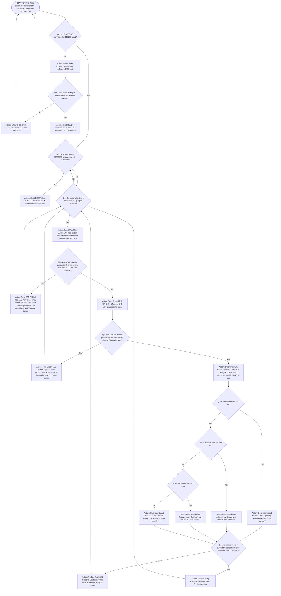

# 04 Flow Chart

Every action is a rectangular box (`[...]`), every question is a diamond (`{...}`) containing a number, every diamond has both a **Yes** and a **No** path out of it, and every path leads back to the Start state.

